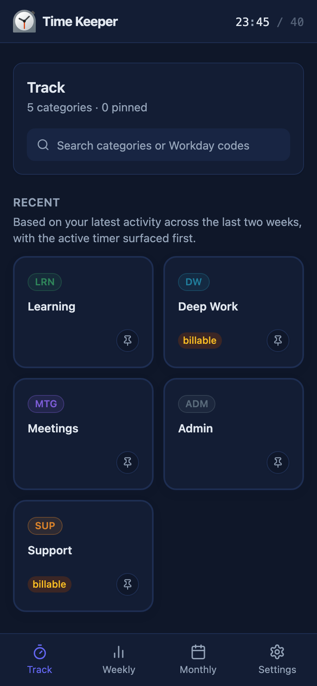
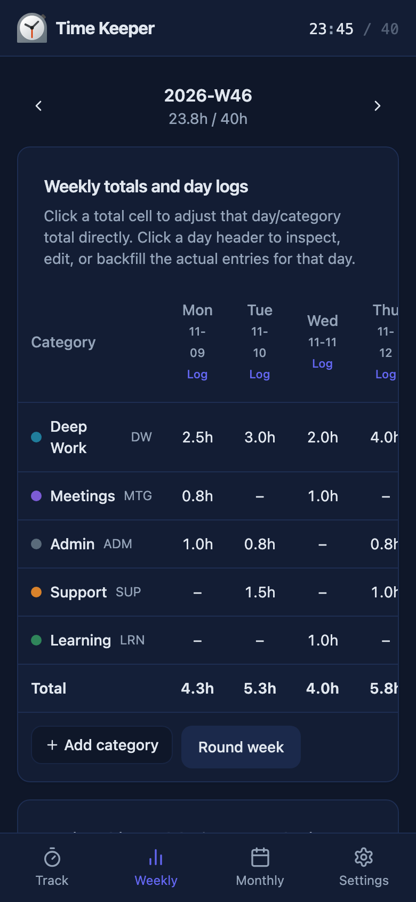
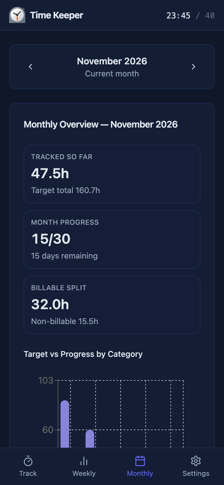
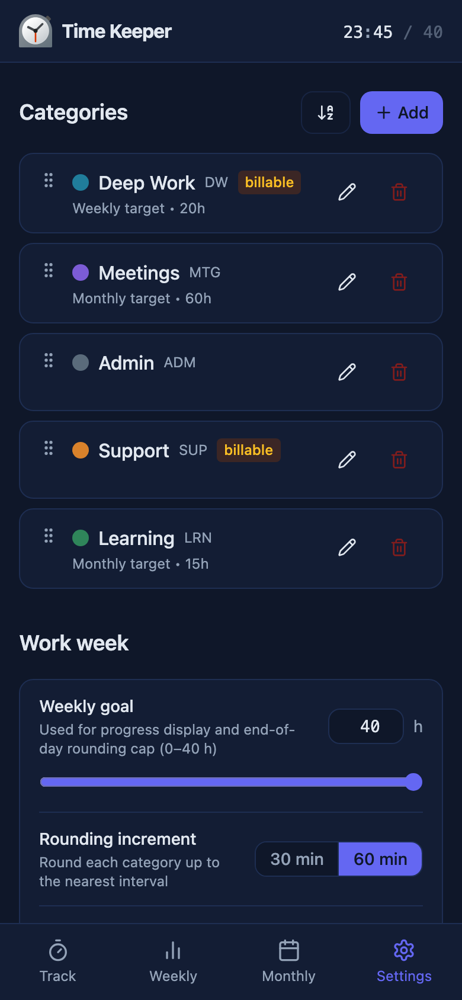
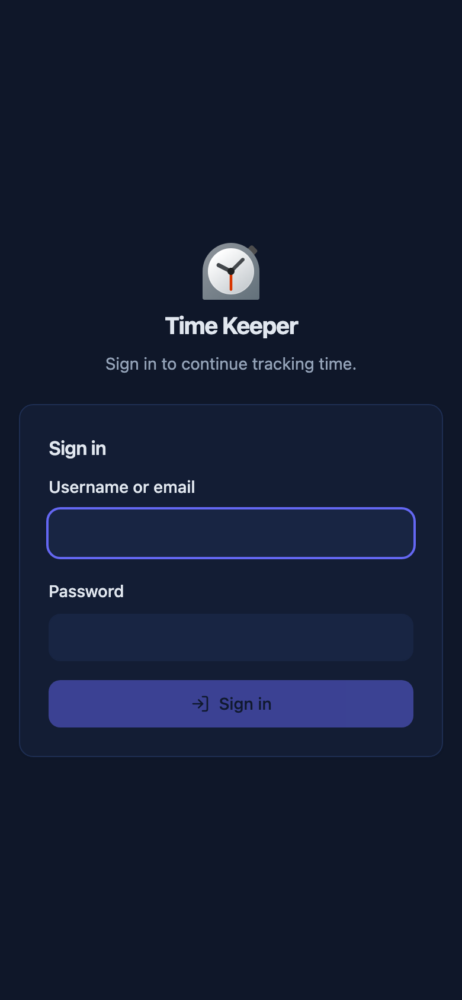
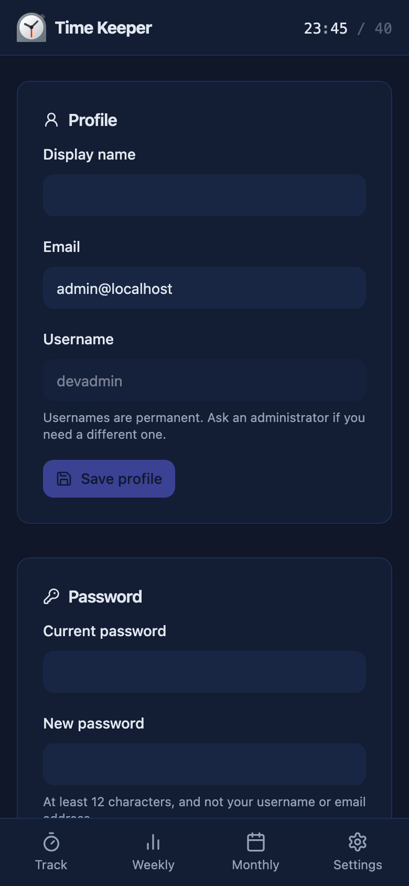
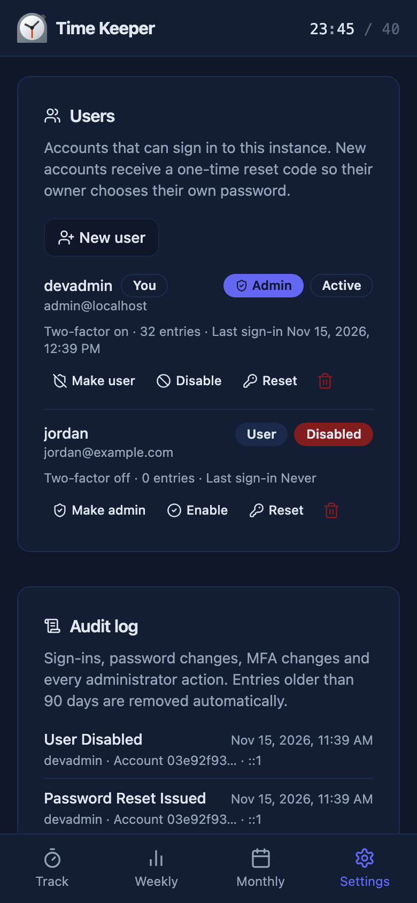
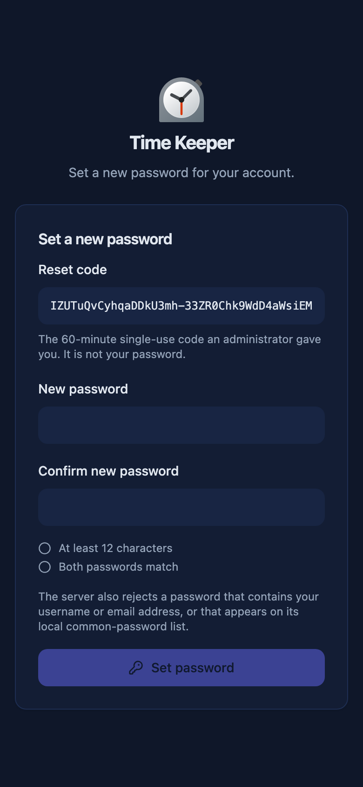
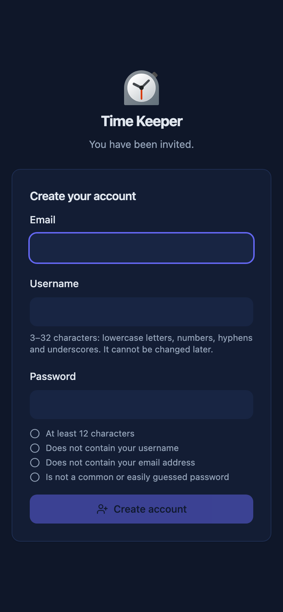

> This project was built entirely by AI (Pi, Claude Code, GPT-5.4) from an empty folder, guided by iterative human prompting. It manages its own documentation in `docs/memory/` and keeps the Wiki and code in sync unprompted. For security and dependency details, see [SECURITY.md](SECURITY.md) and the [Wiki](https://github.com/niels-emmer/time-keeper/wiki).

# Time Keeper

A self-hosted personal work-timer PWA. Track time against named categories from any device, view weekly summaries, and copy them into Workday (or any time registration tool) with one click.

Runs as a PWA — installs to the macOS Dock and Android home screen with no app store required.

## Screenshots

<table>
  <tr>
    <td align="center"><br/><sub><b>Track</b> — tap a category to start</sub></td>
    <td align="center"><br/><sub><b>Weekly</b> — hours by category × day</sub></td>
  </tr>
  <tr>
    <td align="center"><br/><sub><b>Monthly</b> — projected vs actual + billable breakdown</sub></td>
    <td align="center"><br/><sub><b>Settings</b> — categories, targets &amp; weekly goal</sub></td>
  </tr>
  <tr>
    <td align="center"><br/><sub><b>Sign in</b> — local account, no external IdP</sub></td>
    <td align="center"><br/><sub><b>Account</b> — profile, password &amp; 2FA</sub></td>
  </tr>
  <tr>
    <td align="center"><br/><sub><b>Admin users</b> — roles, status &amp; actions</sub></td>
    <td align="center"><br/><sub><b>Reset</b> — redeem a code, set a password</sub></td>
  </tr>
  <tr>
    <td align="center"><br/><sub><b>Register</b> — accept an invite</sub></td>
    <td></td>
  </tr>
</table>


## Features

- **One-tap timer** — tap a category to start, tap Stop to finish; starting a new category auto-stops the previous one, and the Track screen now supports search, pinned categories, and recent-category sections for faster switching
- **Weekly goal** — configurable hours per week (0–40); shown in the top bar and weekly summary, drives the rounding cap
- **Local-day bucketing** — pick your time zone in Settings and entries group by *your* calendar day (00:30 and 23:30 local stay on the day you logged them); storage stays UTC, and the default UTC keeps existing behaviour unchanged
- **Monthly tab** — dedicated monthly planning view with month navigation, per-category targets, status chips, projected vs actual comparison, pace guidance, and billable vs non-billable breakdown
- **Billable activity** — mark categories as billable or non-billable for monthly overview reporting
- **Weekly overview** — time per category per day; click any cell to edit hours inline (totals update live as you type), open day logs to inspect/edit/delete the actual entries, backfill missed work, review the week, and copy or download CSV/plain-text/compact handoff formats
- **End-of-day rounding** — round tracked minutes up to the nearest 30 or 60 minutes (configurable), capped at your weekly goal
- **Light / dark / system theme** — follows your OS preference by default; override per-device in Settings
- **PWA** — installable on macOS and Android, runs in standalone mode (no browser chrome), automatically checks for a new version when the app opens or resumes, shows an in-app update banner when one is ready, and surfaces connectivity status/reconnect feedback
- **macOS status bar app** — native Flutter app lives in the menu bar; icon shows active timer color + `CODE hh:mm`; click to open a popover panel with full Track / Weekly / Settings functionality, including weekly inline cell editing and day-log repair/backfill flows
- **Local accounts** — the app owns sign-in: username or email + password, server-side sessions, self-service profile/password/deletion, and an admin user-management screen. No external identity provider required
- **TOTP MFA** — authenticator-app second factor with ten single-use recovery codes; required for admins, optional for users
- **Invite-only registration** — admins create accounts or mint single-use 72-hour invite links; there is no public signup form
- **Password reset without email** — admins issue single-use 60-minute reset codes out of band; the same `/reset` page handles first passwords for new and migrated accounts
- **Optional Authentik proxy mode** — the pre-accounts forward-auth path is preserved behind `AUTH_MODE=proxy`, so an existing deployment can roll back without a code revert
- **Self-hosted** — runs in Docker with no external services
- **Personal access tokens** — browser-created tokens for the native app, shown once, hashed at rest, and expiring after one year

## Tech stack

| Layer | Choice |
|-------|--------|
| Frontend | React 18 + Vite + Tailwind CSS + shadcn/ui |
| Backend | Node.js 22 + Express + Drizzle ORM |
| Database | SQLite (better-sqlite3, WAL mode) |
| Auth | Local accounts (scrypt + TOTP MFA) with server-side sessions; optional Authentik proxy mode |
| Container | Docker Compose |

## Prerequisites

**To deploy (production):**
- [Docker Engine 24+](https://docs.docker.com/engine/install/) with [Docker Compose v2](https://docs.docker.com/compose/install/)
- [Nginx Proxy Manager](https://nginxproxymanager.com) (or another reverse proxy for TLS) — the app publishes no host ports
- A domain name with SSL
- **Optional:** an [Authentik](https://goauthentik.io) instance only if you choose `AUTH_MODE=proxy` (see the [auth integration guide](docs/integration/auth.md))

**To develop locally:**
- [Node.js 22+](https://nodejs.org/en/download) — ([nvm](https://github.com/nvm-sh/nvm) / [fnm](https://github.com/Schniz/fnm) recommended for version management)
- [Yarn 4](https://yarnpkg.com/getting-started/install) via Corepack (ships with Node.js 16.9+)

## Quick start (local development)

```bash
# 1. Install dependencies (requires Node 22+ and Yarn 4 via corepack)
corepack enable
yarn install

# 2. Start the backend (Terminal 1)
#    Seeds a dev admin on first run: admin@localhost / this password
DEV_ADMIN_PASSWORD='a long dev passphrase' yarn workspace @time-keeper/backend dev

# 3. Start the frontend (Terminal 2)
yarn workspace @time-keeper/frontend dev
```

Open http://localhost:5173 and sign in at `/login` with `admin@localhost` and the password you
set. If you omit `DEV_ADMIN_PASSWORD`, a random one is printed once at first boot. This is the
real local login path — sessions and MFA included. (`DEV_USER_ID` is a proxy-mode-only shortcut;
see [local dev](docs/operations/local-dev.md).)

The backend listens on `http://localhost:3001`. If that port is already taken (the Orchestrator desktop app's daemon uses it), move the backend with `PORT` **and** point the frontend at it with `VITE_API_URL` — setting only one leaves the UI calling a dead port. See [local dev → Ports](docs/operations/local-dev.md#ports-read-this-if-the-backend-will-not-start).

## Deployment

See [docs/operations/deployment.md](docs/operations/deployment.md) for the full guide, including:
- Docker Compose setup and the required secrets
- Nginx Proxy Manager configuration
- The local-auth cutover, first-admin bootstrap, and rollback to Authentik

The short version:
1. Clone the repo on your VPS and `cp .env.example .env`
2. Generate `SESSION_SECRET` (`openssl rand -base64 48`) and `MFA_ENCRYPTION_KEY`
   (`openssl rand -base64 32`), and set `ADMIN_EMAIL`. `AUTH_MODE` defaults to `local`
3. Run `APP_VERSION=$(git describe --tags --abbrev=0) docker compose up -d --build` for the first deploy
4. Read the boot logs for the one-time first-admin reset code, open `/reset?code=…`, and set the
   admin password (a fresh database)
5. Add a proxy host in NPM forwarding to `frontend:80` over the external `proxy-net` Docker network
   (nothing is published to the host), with SSL
6. Use `./refresh-vps.sh` for later pull-and-rebuild updates
7. **Only for `AUTH_MODE=proxy`:** create an Authentik Proxy Provider (forward auth) and add the
   standard Authentik Advanced config to the NPM host. See the [auth guide](docs/integration/auth.md).

## Documentation

| Path | Contents |
|------|----------|
| [Wiki](https://github.com/niels-emmer/time-keeper/wiki) | Full user and operator documentation |
| [AGENTS.md](AGENTS.md) | Entry point, bootstrap order, and the canonical catalog for repo-local Pi surfaces |
| [.pi/APPEND_SYSTEM.md](.pi/APPEND_SYSTEM.md), [.pi-rules](.pi-rules), [.pi-context](.pi-context), [CONTEXT.md](CONTEXT.md) | Repo-local operating contract, workspace rules, and bootstrap context |
| [.pi/settings.json](.pi/settings.json), [.pi/extensions/](.pi/extensions/), [.pi/skills/](.pi/skills/), [.pi/agents/](.pi/agents/), [.pi/prompts/session-init.md](.pi/prompts/session-init.md) | Repo-local Pi packages, extensions, skills, agents, and prompts |
| [docs/memory/INDEX.md](docs/memory/INDEX.md) | Architecture overview, routing, and deeper links |
| [docs/integration/](docs/integration) | Auth, Docker, PWA, and native-app integration docs |
| [docs/operations/](docs/operations) | Local development, deployment, and runbooks |
| [packages/macos_app/README.md](packages/macos_app/README.md) | macOS status bar app build and setup |
| [SECURITY.md](SECURITY.md) | Security posture, risks, and dependency audit |

Repo-local Pi surfaces above are defined by this repository. Your runtime may also expose additional builtin or user-level agents, but those are environment-specific and are not part of Time Keeper's repo contract unless documented here or in `AGENTS.md`.

## Customising categories

Categories are managed in the app itself (Settings tab). Add one category per booking type you want to track, then optionally configure target hours directly in the category editor as a monthly target, weekly target, or one-time budget. The optional "Workday code" field appears in the weekly copy output.

## Multi-user support

The app is multi-user by design. Every account has a UUID in the `users` table, and every
category, time entry and setting is a foreign key to it. Each user sees only their own data.

- Registration is invite-only: an administrator creates an account or mints a single-use invite in
  **Settings → Users** (visible to `role='admin'` only).
- Administrators can change roles, disable an account, issue password-reset codes, and delete an
  account (cascading its data or reassigning its entries to themselves).
- There is no shared data and no cross-user reporting. The admin surface is minimal by design —
  user management plus an audit log, not surveillance.

In `AUTH_MODE=proxy` the same isolation holds; an Authentik user is resolved to their `users` row by
email, and an unseen email is provisioned on first sight.

## Attribution

Original idea and product direction by the author. Built entirely by AI: [Pi](https://pi.dev), [Claude Code](https://claude.ai/claude-code) (Claude Sonnet 4.5 / Opus 4.6, Anthropic), and [GPT-5.4](https://openai.com/gpt-4) (OpenAI). Guided by exceptional iterative prompting — the key to coherent, self-documenting AI-driven development.
